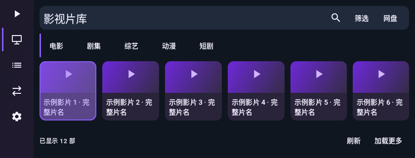
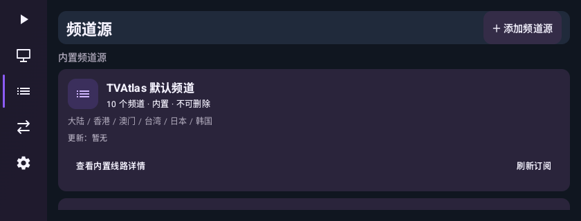
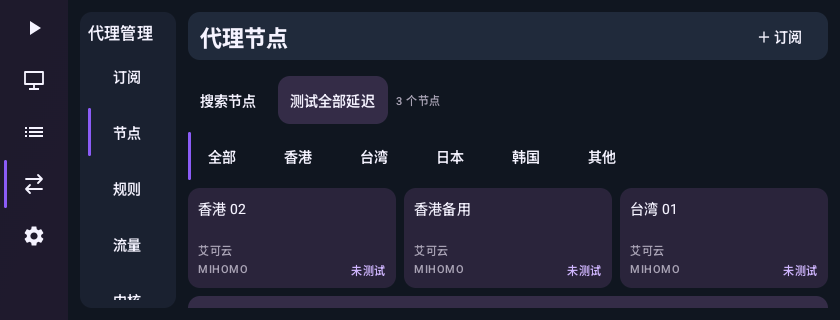
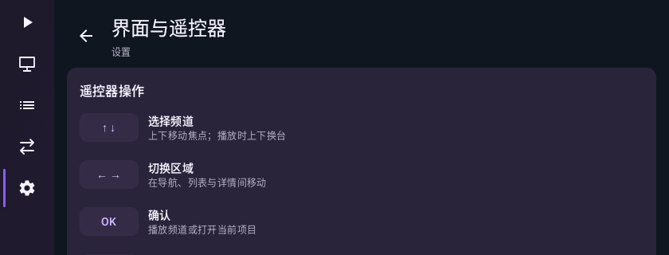

# 小屏横屏布局修正 · 56.2

用户在 55.1 提供两张手机横屏截图：影视页主导航和二级侧栏占用过多宽度，四个大筛选块占用高度，首行海报下的名称落在列表视口之外；频道源在相同高度下自动显示双栏详情，两栏内容均拥挤。此前的 55.1 组件统一与常规电视截图没有覆盖这一可用高度，不能代替小屏横屏验收。

## 参考资料的实际查阅范围

重新读取了用户指定的四个公开仓库 README，没有借用其源码或素材。

- [APTV](https://github.com/Kimentanm/aptv)：本次成功下载并查看 iOS 频道网格公开截图。可借鉴图片与名称分开、导航和内容职责清晰；tvOS 截图仍不可访问，未声称查看过。
- [Meroser/IPTV](https://github.com/Meroser/IPTV)：是频道资料/播放器推荐集合。取到的 IPTV Player 图片是标志，不是应用操作界面，不作为页面布局证据。
- [LunaTV](https://github.com/QWiseDev/LunaTV)：读取公开 README 的功能说明与演示入口，本次没有取得可验证的演示页面截图，不据此宣称观察过实际交互。
- [mytv-android](https://github.com/mytv-android/mytv-android)：读取公开 README；其当前 README 的 dashboard/channels 相对截图地址本次返回不可用，未声称查看过这些界面。

本轮主要视觉依据是用户提供的真实问题截图及可查看的 APTV 公开界面，后者仅用于信息层次参考；不把未访问的界面或服务端实现写成研究结论。

## 实现

1. **影视工具区**：搜索、筛选与标题同排，移除四个独占一行的大筛选按钮。条件仍通过现有筛选弹窗修改；一般高度显示一行条件摘要，短高度隐藏次要说明以留出内容空间。
2. **按可用宽高分配空间**：影视二级侧栏只在宽度、高度均充足时出现；短横屏用一行内容分类。非直播页面在短高度使用 68dp 图标主导航，保留语义标签、焦点与滚动。直播导航与播放行为保留。
3. **名称优先**：网格视口较矮时，海报高度随剩余空间减少，隐藏次要分类标签，保留两行片名。首行片名使用独立 testTag 检查完整边界，不以海报里的占位文字冒充名称可见。超长名称仍可能在两行后省略。
4. **频道源**：宽高不足时使用单列，不自动展示右侧详情；内置来源详情通过按钮/点击打开。常规电视宽屏保留双栏。
5. **区域层次**：非直播内容底、二级导航、工具栏使用不同深色层级；紫色继续用于焦点、选中标识及卡片强调。共享页头统一主标题、次级说明与动作的对齐。
6. **其他短屏收尾**：代理侧栏缩窄、节点数量与动作同排；设置用可滚动分组页/返回入口，取消窄屏重复标题。影视底部计数可省略，刷新和加载更多使用紧凑文字动作。

## 当前截图与检查结果

来自 Actions 39135804379 的 Android 35 模拟器，使用示例数据。短横屏为 840×320dp，近似用户截图的内容区域比例，不是原设备截图。影视截图使用真实公共工具栏、分类组件、网格和页脚，未连接真实影视聚合服务；不冒充完整在线片库验收。

### 1. 小屏横屏影视——已检查

首行六张示例卡片同时显示海报和两行名称；标题、搜索/筛选工具同排。新增回归另在 720×136dp 的网格视口中断言首行片名完整边界位于视口内。

### 2. 小屏横屏频道源——已检查

取消自动双栏详情，首张来源卡片的名称、统计和动作均可见，其余内容正常滚动。新增回归断言默认来源名称只出现一次，自动详情提示不存在。

### 3. 小屏横屏代理——已检查

节点数量并入动作区，首行节点的名称、订阅、内核和状态均可见。二级菜单/更多节点仍需滚动，不承诺所有内容同时显示。

### 4. 小屏横屏设置——已检查

以返回入口替代拥挤的二级侧栏；当前页标题仅显示一次。长说明区域可滚动，不压缩字体来显示全部内容。

### 5. 常规尺寸复核——已检查

同时检查了 `ui-tv-1..4.png`、`ui-phone-2..4.png` 共七张常规电视/手机截图，位于同目录。正常电视保留宽导航及适合的多栏；手机竖屏保留底部导航。没有把静态截图当作全部交互或无障碍合规证明。

## 验证

- 250 项 JVM 测试全部通过，无失败、错误或跳过；lint、Android 测试编译、预览构建通过。
- Actions 39135804379 完整模拟器交互及覆盖安装检查通过。
- 上一轮唯一失败是 MobileLiveLayoutTest 在 Dispatchers.Default 上的频道索引完成前输入搜索；测试现显式等待搜索框出现，再执行原有选台与失败布局断言，没有修改生产直播处理。
- 最终 APK：`1.5.3-preview.56.2-localte`，versionCode 1000056，固定预览签名，可覆盖 55.1；正式版仍为 1.5.3，未发布更新。

限制：真实海报、超长片名、不同字体缩放、软键盘和原设备上的弹窗/方向键仍需真机复测；不承诺任意极矮窗口都能同时显示海报与全部文字，也不凭模拟器证明性能提升。
