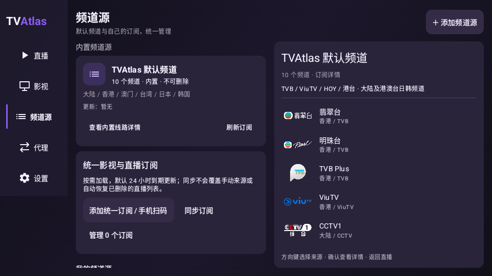
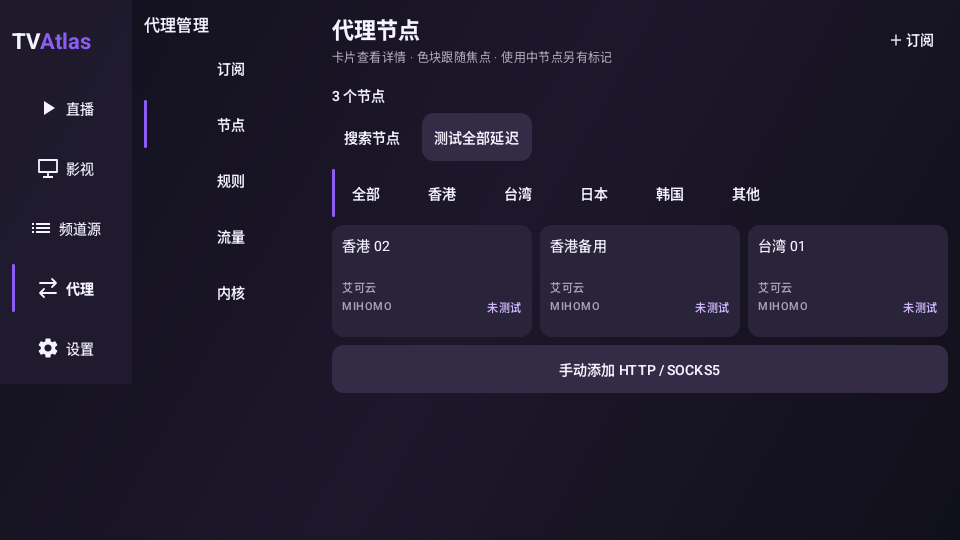
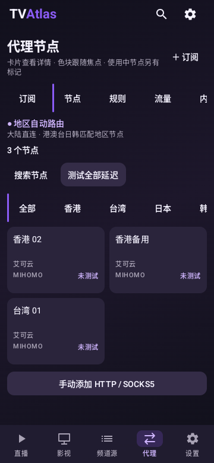
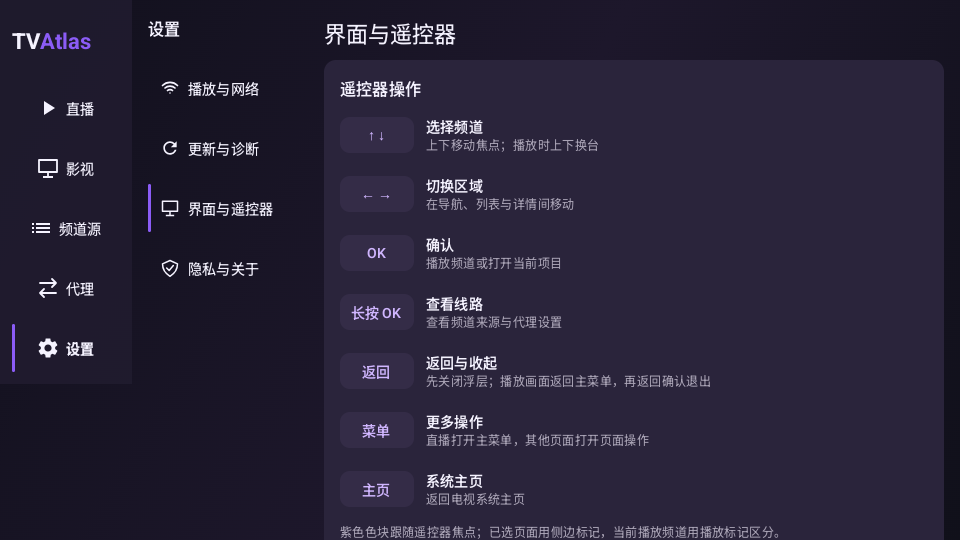
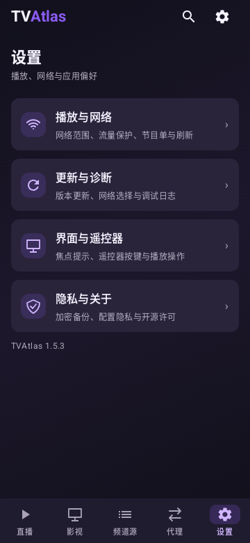
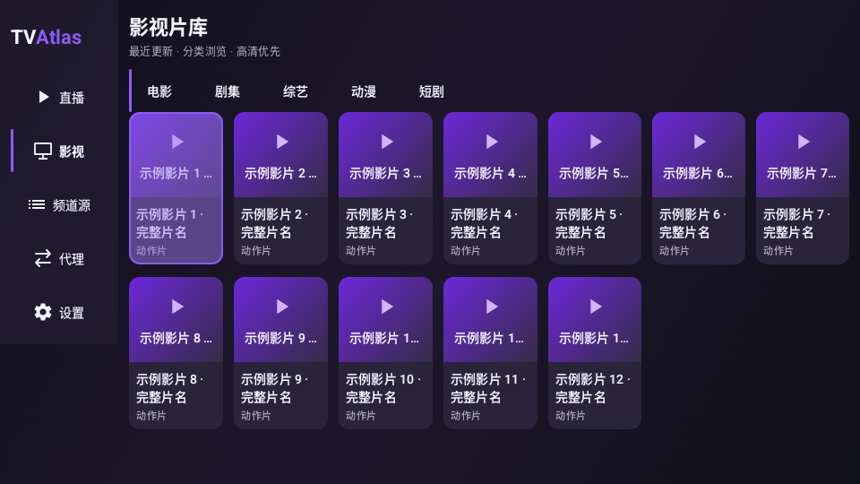
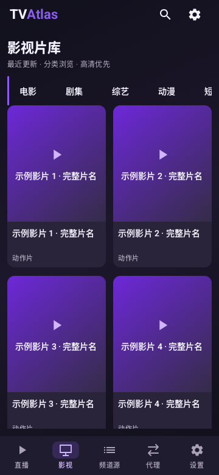

# 非直播页面样式统一 · 55.1

目标：以已修好的直播交互为基础，统一非直播页面的公共组件。直播播放器布局、控制栏与遥控器处理没有修改；不发布正式版。

## 实现

- `AtlasPageStyle` 集中定义 12dp 圆角、176dp 二级侧栏和公共间距。
- `AtlasCard` 统一静态/可点击卡片形状与零阴影；各页面使用同一层级底色。
- `AtlasActionButton` 统一普通操作的实底外观，继续使用已有的即时焦点绘制。
- 影视、频道源、代理、设置、网盘、内核、翻译设置接入组件。
- 影视/代理/设置二级导航宽度与标题字号统一；设置保留图标，影片保留适合海报的网格，未将不同内容硬改为相同布局。

## 当前版本截图检查

来源：本次 GitHub Actions 39131416319 的 Android 35 模拟器 UI 组件测试，用示例频道、代理与无网络影视数据。以下 PNG 是模拟器截图，已逐张查看，非设计稿。没有成功取得改动前同一组截图，因此不提供前后视觉对比或声称已完成全流程产品审计。

1. **频道源（电视）——公共样式已接入。** 来源卡片、详情面板、操作按钮层级一致；当前示例没有文字重叠。内容较多时仍需滚动，不代表所有来源名称都已实测。

   

2. **代理（电视/手机）——卡片和操作按钮已统一。** 二级导航与内容分列，节点名与状态分行。手机顶部/地区分类条横向滚动，右侧选项不会全部同时出现；截图不证明所有滚动与焦点状态均已视觉验收。

   
   

3. **设置（电视/手机）——面板、卡片与按钮风格一致。** 手机按设置分组进入，电视侧栏保留分类；电视长说明可滚动。截图不代表每个子页和弹窗均被逐一打开检查。

   
   

4. **影视公共片库组件（电视/手机）——卡片、分类按钮与双行片名已统一。** 电视焦点在第一部影片，紫色反馈可见；截图为占位海报及公共网格预览，不是在线聚合片库的完整交互验收。

   
   

## 自动验证与限制

250 项 JVM 单元测试无失败、错误或跳过；lint、Android 测试编译、完整模拟器交互及覆盖安装检查通过。首次应用代码验证运行 39130768155；随后仅调整截图输出分段，运行 39131416319 再次通过。

预览包：1.5.3-preview.55.1-localte / 1000055，固定预览签名，可覆盖已有预览版。正式更新通道仍为 1.5.3。

没有电视真机、真实长片名/大订阅/系统大字体的全部状态截图；自动验证不能承诺所有设备视觉效果或完整无障碍合规。第三方海报、视频播放及字幕可用性不属于本次静态截图结论。
