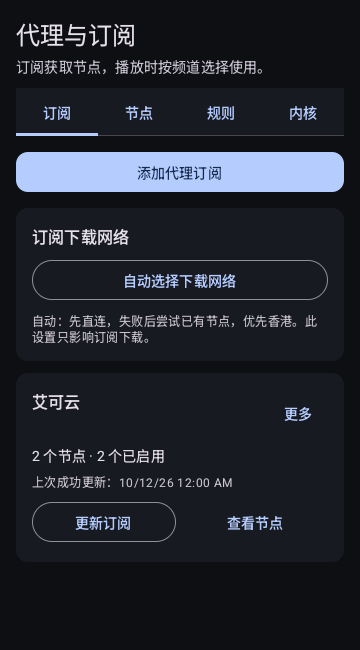
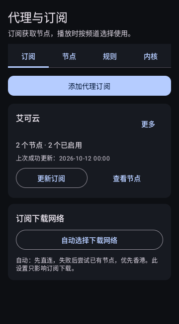
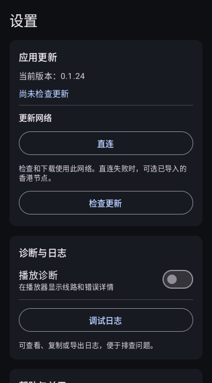
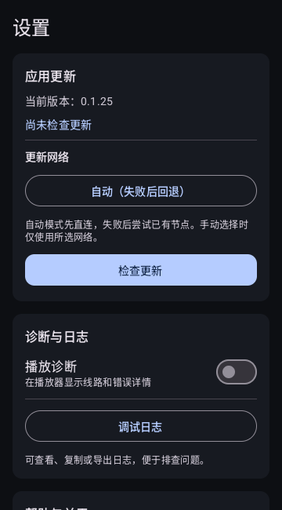
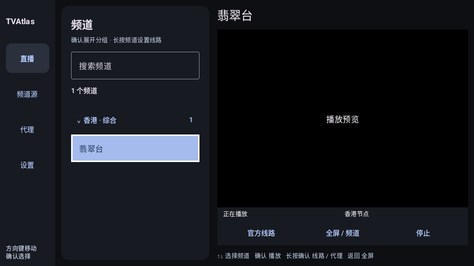
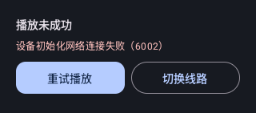

# 本轮 UI 审查截图

截图来自本轮 Android API 35 原生组件测试，使用合成数据；已保存并逐张查看。它们不是用户私有节点的真实播放截图。

[完整代码与 UI 审计](../../android-player/docs/fallback-audit.md) · [回归检查](https://github.com/hoylturtle/TVAtlas/actions/runs/38282802514)

## 1. 手机订阅管理 — 已调整

订阅卡片优先展示，更新与查看节点更容易找到。下载网络设置后置，错误仍留在对应订阅卡片。

| 调整前 | 调整后 |
| --- | --- |
|  |  |

## 2. 手机设置 — 已调整

更新卡片保留清楚的状态，检查更新使用主按钮；加入自动回退网络和取消。帮助保持折叠，降低初始页面的信息量。

| 调整前 | 调整后 |
| --- | --- |
|  |  |

## 3. 电视导航和焦点 — 保留并统一名称

实色焦点和白边保持清楚，导航名称与手机一致。方向键与确认键已有行为回归；不同电视遥控器与 TalkBack 的实际体验仍需真机验证。

[调整前完整截图](before/tv-layout.png)

## 4. 失败恢复 — 新增操作入口

失败后明确提供重试和切换线路，不要求用户先去设置页。320 dp 窄屏按钮可见性与点击回归通过。此图是组件截图，完整播放页面尚需真机验证。

